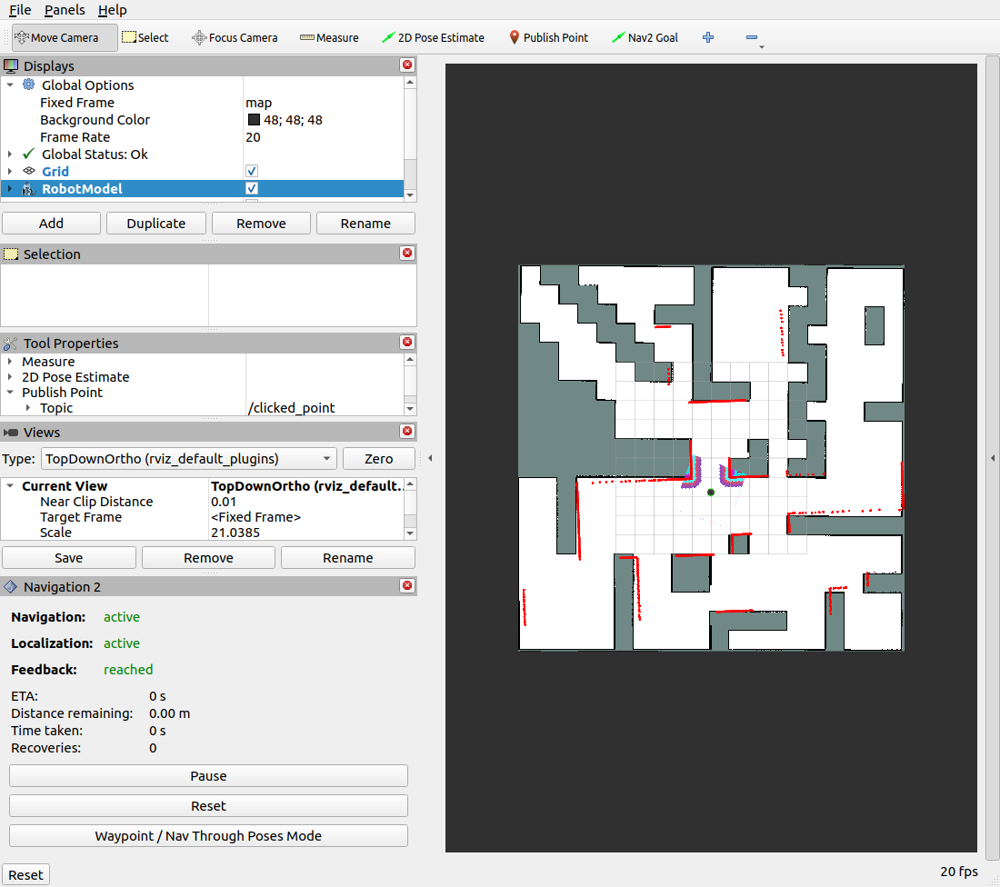

# TurtleBot 4 SLAM & Nav2 — ROS 2 Humble

Bài thực hành TurtleBot 4 Lite trong Gazebo Fortress: kiểm tra sensor,
điều khiển bằng bàn phím để tạo map với SLAM Toolbox, lưu map, localization
bằng AMCL và di chuyển tự động bằng Nav2. Sử dụng world `maze` và simulator,
controller có sẵn của TurtleBot 4.

## Clone và build

Trên máy mới, sử dụng `~/ros2_ws` làm workspace:

```bash
git clone https://github.com/linhnghu/turtlebot4-slam-nav2.git ~/ros2_ws
cd ~/ros2_ws
sudo apt install ros-humble-turtlebot4-simulator ros-humble-irobot-create-nodes \
  ros-humble-slam-toolbox ros-humble-navigation2 ros-humble-nav2-bringup \
  ros-humble-teleop-twist-keyboard
source /opt/ros/humble/setup.bash
colcon build --symlink-install --packages-select turtlebot4_lab
```

## Chạy bài thực hành

Mỗi thời điểm chạy một chế độ. Giữ terminal launch chạy khi sử dụng RViz và
các terminal phụ. Để chuyển chế độ, chạy `./stop_turtlebot4.bash` rồi khởi động lại.

| Chế độ | Lệnh trong workspace |
|---|---|
| Simulation và RViz | `./run_turtlebot4.bash mode:=simulation` |
| SLAM và RViz | `./run_turtlebot4.bash mode:=mapping` |
| AMCL với map đã lưu | `./run_turtlebot4.bash mode:=localization map:=$HOME/ros2_ws/maps/map.yaml` |
| AMCL + Nav2 | `./run_turtlebot4.bash mode:=navigation map:=$HOME/ros2_ws/maps/map.yaml` |

Khi mapping, mở terminal thứ hai:

```bash
cd ~/ros2_ws
./run_teleop.bash
```

Script tự nạp môi trường ROS và undock robot nếu cần. Đợi `Teleop ready`,
focus terminal và giữ `i` để đi, `j/l` để quay, `k` để dừng. Lưu map khi
SLAM vẫn đang chạy:

```bash
./save_map.bash
```

Kết quả nằm tại `maps/map.yaml` và `maps/map.pgm`.

Localization/Nav2 mặc định khởi tạo pose `(0, 0, yaw=0)` trên map, tương ứng
vị trí spawn mặc định của bài. Có thể đặt lại pose bằng **2D Pose Estimate**
trên RViz, truyền `initial_x`, `initial_y`, `initial_yaw`, hoặc chọn
`auto_initial_pose:=false` để thực hành tự khởi tạo.

Khi Navigation và Localization trên RViz đều `active`, undock từ terminal phụ:

```bash
cd ~/ros2_ws
source turtlebot4_env.bash
ros2 action send_goal /undock irobot_create_msgs/action/Undock '{}'
```

Dùng **Nav2 Goal** trong RViz hoặc gửi một tọa độ theo frame `map`, ví dụ:

```bash
ros2 action send_goal /navigate_to_pose nav2_msgs/action/NavigateToPose \
"{pose: {header: {frame_id: map}, pose: {position: {x: -2.0, y: 0.0, z: 0.0}, orientation: {w: 1.0}}}}" \
--feedback
```

Chọn goal trong vùng trống đã khảo sát và đóng teleop trước khi gửi goal.

## Kiểm tra và cấu hình

```bash
cd ~/ros2_ws
source turtlebot4_env.bash
ros2 run turtlebot4_lab check_topics.py --require-map
ros2 run tf2_ros tf2_echo map base_link --ros-args -p use_sim_time:=true
```

`turtlebot4_env.bash` dùng ROS domain `49`, Fast DDS qua UDP loopback và nạp
workspace. Có thể chọn domain khác bằng `TURTLEBOT4_LAB_DOMAIN_ID`.
Overlay `.turtlebot4_compat/` được tạo từ các package đã cài để chọn Ogre 2
cho LiDAR và camera Gazebo nhìn từ trên cao; không sửa `/opt/ros`.

## Nội dung repo

- `src/turtlebot4_lab/`: ROS package, launch bốn chế độ, RViz và công cụ kiểm tra.
- Các script ở root: môi trường, quản lý phiên, teleop và lưu map.
- `maps/`: bản đồ `maze` được lưu từ SLAM.
- [README_TURTLEBOT4.md](README_TURTLEBOT4.md): hướng dẫn chi tiết bốn phần.
- [artifacts/VALIDATION.md](artifacts/VALIDATION.md): kết quả kiểm thử, log và ảnh.

Simulator, mô tả robot và controller được cài qua các package ROS chính thức.
`build/`, `install/`, `log/`, cấu hình IDE và overlay tự sinh được bỏ qua khi commit.

## Kiểm thử đã thực hiện

Đã kiểm tra các topic, teleop, lưu/load map, AMCL và Nav2 trên máy phát triển.
Ba goal Nav2 trong lần thử ngày 07/10/2026 đều SUCCEEDED. Ngày 13/10/2026,
đã kiểm tra teleop di chuyển 0.349 m và khởi tạo AMCL tự động; goal `(-2, 0)`
SUCCEEDED trên bản map người dùng lưu lại. Xem báo cáo để biết từng map và
điều kiện thử; video khảo sát và các goal RViz cho bài nộp cần thực hiện riêng.



## License

Source của package sử dụng [Apache-2.0](LICENSE). Các dependency TurtleBot 4,
Create 3, Gazebo và Nav2 giữ license của dự án tương ứng.
